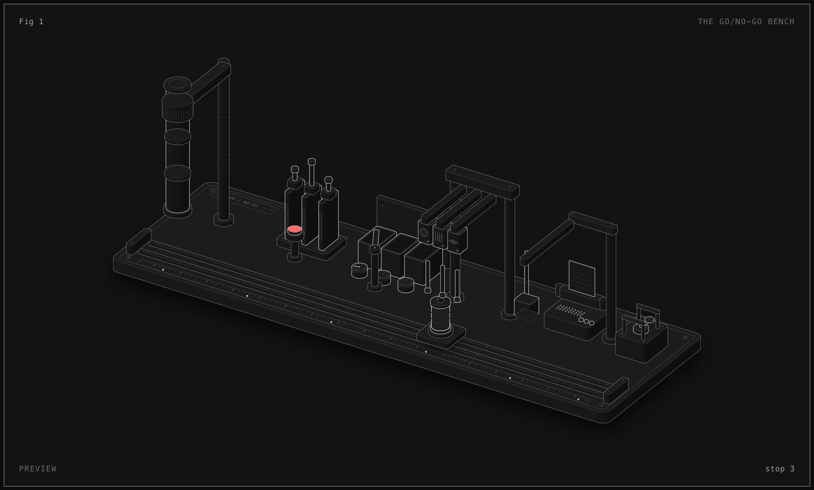

# Mission Control: Go/No-Go Launch Console

Engineers file anomaly reports. A pipeline sorts each one, checks the readings against the launch limits **in plain code**, runs three model checks at the same time, and drafts a briefing that a second model call reviews (up to three rounds). The Flight Director sees the verdict, the briefing, the cost and a card for every step, and **only a person can approve**.



## Run it

```bash
docker compose up --build
```

Open <http://localhost:8088>. Use **File report** to send one, and **Flight Director** to review and approve.

The model runs locally in [Ollama](https://ollama.com). Start it before the app:

```bash
OLLAMA_NUM_PARALLEL=3 ollama serve
ollama pull qwen3:14b
```

No model running? `LLM_PROVIDER=fake docker compose up --build` runs everything with an offline stand-in.

## Test it

```bash
make test
```

That runs the backend tests (pytest, with network sockets blocked and no API key) and the front-end tests (Vitest). The other checks:

| Command | What it checks |
|---|---|
| `make e2e` | Playwright: file a hidden-instruction report, see it stay NO-GO and flagged, approve it as a person |
| `make smoke` | The real model in Ollama, end to end on three sample reports (not in CI) |
| `make figures` | Every line in the bench figure ends on something |
| `make openapi` | Regenerates `openapi.json` and the front-end types (CI fails if they drift) |

Prerequisites for the test commands: [uv](https://docs.astral.sh/uv/) and Node 24.

## Model-agnostic by design

Every model call goes through one interface (`backend/app/llm/base.py`). The real adapter speaks the **OpenAI-compatible Chat Completions API** with JSON-schema structured output, which Ollama serves at `/v1`. Switching to LM Studio, vLLM, OpenRouter or a hosted provider means changing `.env` (see `.env.example`), not code:

```
LLM_BASE_URL=http://host.docker.internal:11434/v1
LLM_MODEL=qwen3:14b
LLM_MODEL_FAST=      # optional: smaller model for classify and the three checks
LLM_MODEL_WRITER=    # optional: stronger model for draft and review
```

Choosing a local model for a 24 GB Apple-silicon laptop: one 8–14B instruct model at 4-bit fits alongside three parallel contexts. Run `make smoke` before you commit to one; it fails if the model cannot return valid structured output.

The app's own REST API is described by `openapi.json`, which FastAPI generates from the code.

## How it fits together

| Step | Done by | Code |
|---|---|---|
| Validate and save the report | Code | `backend/app/schemas.py`, `db.py` |
| Launch limits → verdict and violations | **Code** | `backend/app/limits.py` |
| Subsystem and severity (schema, validated, falls back to other/high) | Model | `backend/app/classify.py` |
| Brief-by 5/15/30 min (any violation counts as high) | Code | `backend/app/brief_by.py` |
| Hidden instructions, missing details, panic (run in parallel) | Model ×3 + code backstop | `backend/app/checks.py` |
| Draft ⇄ review, max 3 rounds, feedback goes into the next draft | Model | `backend/app/briefing.py` |
| Cost per step and per report | Code | `backend/app/cost.py`, `trace.py` |
| Approval | **Person only** | `POST /api/reports/{id}/approve` |

The verdict is fixed before any model reads the note, and the limits function does not take the note as an argument, so a note full of instructions cannot change it. `docs/HOW_IT_WORKS.md` explains the whole design, and `TOOL_CHOICES.md` explains why each tool was chosen.

## Development

```bash
cd backend && LLM_PROVIDER=fake uv run uvicorn app.main:create_app --factory --port 8010
cd frontend && API_URL=http://localhost:8010 npm run dev
```

Workflow: every change lands through a pull request into a protected `main`. Each slice has a red `test:` commit before its `feat:` commit, and the commits follow Conventional Commits. CI runs backend, contract, frontend, figures, e2e and docker jobs.
