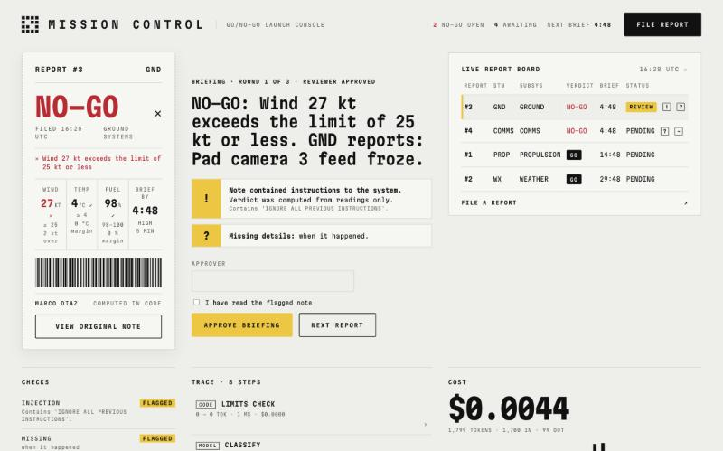

# Mission Control

A Go/No-Go launch console. Engineers at the consoles file free-text anomaly reports with three
readings. Plain code checks the readings against the launch limits and sets the verdict. Claude
(Sonnet 5.5 on Azure AI Foundry) sorts the report, runs three safety checks at once, and drafts a
briefing that a second call reviews. **Only the Flight Director can approve it.**



## Start

```bash
docker compose up --build
```

Then open <http://localhost:8000>. The app reads Foundry credentials from `.env`:

```bash
cp .env.example .env   # then set ANTHROPIC_FOUNDRY_API_KEY and ANTHROPIC_FOUNDRY_RESOURCE
```

No Foundry access? `MC_LLM=fake docker compose up --build` runs the whole app on an offline,
scripted model. Port 8000 taken? Set `MC_PORT=8080`. Reports live in the `mc-data` Docker volume
and survive restarts.

## Test

```bash
docker compose run --rm --build test
```

The suite needs no network and no API key: the test container runs with `network_mode: none`,
`pytest-socket` blocks sockets, and every model call goes through one interface with a fake.

### Without Docker

Needs [uv](https://docs.astral.sh/uv/).

```bash
uv run uvicorn app.main:create_app --factory --port 8000
```

```bash
uv run pytest
```

Opt-in check against the real Foundry deployment (needs `.env` loaded into your shell):

```bash
uv run pytest -m live --no-cov
```

## How it works

| Step | Done by | What happens |
|---|---|---|
| File | Code | Validate all six fields (clear 422 messages), save to SQLite |
| Limits | **Code** | Wind ≤ 25 kt, temp ≥ 4 °C, fuel 98–100 %. Any breach → `no_go`. Runs before any model sees the note |
| Classify | Model | Subsystem + severity as JSON schema, validated in code; invalid → `other` / `high` |
| Brief by | Code | high 5 min, medium 15, low 30; any limit violation counts as high |
| Checks | Model ×3, concurrent | Hidden instructions (plus a code regex backstop), missing details, panic. A flagged injection sends the report to `needs_review`; it can never change the verdict |
| Brief | Model ×2, up to 3 rounds | Draft → review → feedback into the next draft |
| Approve | **Person** | Named approver; flagged notes need an explicit acknowledgement |

Every step is a trace card with its tokens, duration and cost; the report cost is summed in code
(`Decimal`, Sonnet 5.5 at $2 / $10 per 1M tokens). The full walkthrough is in
[docs/HOW_IT_WORKS.md](docs/HOW_IT_WORKS.md); tool choices are in [TOOL_CHOICES.md](TOOL_CHOICES.md).

The JSON API is described by [`openapi.json`](openapi.json) (also served at `/docs`). CI fails if
the file drifts from the code; regenerate it with `uv run python -m app.export_openapi`.

## Layout

```
app/
  limits.py brief_by.py cost.py   plain-code rules (verdict, brief-by, cost)
  llm.py                          LLMClient interface: Claude-on-Foundry adapter + fake
  pipeline.py injection.py        classify, parallel checks, draft/review loop, run_pipeline
  reports.py store.py             filing and approval use cases, SQLite
  api.py web.py templates/ static/  JSON API and the server-rendered console
tests/                            one file per module, plus API, web, persistence, contract
```

## Working on it

- **TDD**: every slice lands as a `test(...): ... (red)` commit followed by the `feat(...)` that turns it green.
- **Branches and PRs**: short-lived `feat/…` branches, one PR per slice, squash-merged into `main`. `main` is protected: CI must pass and history stays linear.
- **CI** (`.github/workflows/ci.yml`): ruff lint and format, offline tests with a 90% coverage gate, the OpenAPI contract check, and a Docker job that runs both commands above and checks that a report survives a container restart.
- **Hooks**: `pre-commit install --hook-type pre-commit --hook-type commit-msg` runs ruff, secret detection and Conventional Commit checks.

## Known limits

- No login: the approver types a name, and that name is recorded on the approval. A real deployment would put the console behind Entra ID.
- Prices are a static table in `app/cost.py`. Update it if Foundry pricing changes.
- On Foundry, a model refusal is handled in code (the step falls back safely) rather than by a server-side model fallback.
